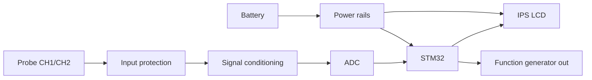

<!-- ============ HEADER ============ -->
<div align="center">


<a href="https://git.io/typing-svg"></a>

<br/>

<a href="https://www.linkedin.com/in/atharva-kalage-01692a28a"></a>
<a href="mailto:atharvakalage@gmail.com"></a>


</div>

<br/>

## ⚡ Who Am I

```text
> name       : Atharva Kalage
> role       : Final-year E&TC engineer (CGPA 9.0/10) · PCCOER, Pune 🇮🇳
> obsessed   : reliable electronics, space-grade parts, clean PCBs
> intern     : Hardware @ Bit Mapper Integration  (Aug 2026 → Jan 2027)
> building   : STM32 + Pico portable scope / function gen / multimeter
> looking 4  : hardware design roles (PCB · high-reliability · FPGA/video · robotics)
```

I like hardware that **works on the bench, then keeps working**: sensible derating, clean power, protected inputs, and tests that go past "it powers on." 🔬

---

## 🔥 Currently

| 🛠️ Building | 📚 Researching | 🎯 Aiming for |
|:---:|:---:|:---:|
| Portable 3-in-1 test instrument *(BE final-year project)* | Space-grade & high-reliability components | Hardware design role in high-reliability / video / FPGA electronics |

---

## 🧪 Featured projects

<table>
<tr>
<td width="50%" valign="top">

### ⚡ Pocket Test Instrument
**Oscilloscope + function generator + multimeter in one battery-powered box.**<br>
🎓 *BE final-year project · in progress*

2-ch protected input → ADC → STM32 → IPS LCD. Built around **STM32 + Raspberry Pi Pico**.

  

🔗 `stm32-portable-scope-multimeter` *(add link)*

</td>
<td width="50%" valign="top">

### 🚁 Flight Controller PCB
**STM32F405 board, multi-layer, compact.**

Component selection → schematic → layout in **KiCad**. Multi-sheet design (power, MCU + USB, sensors, motor I/O). Pin-mux conflicts caught in review, not on the bench.

  

🔗 `stm32f405-flight-controller-pcb` *(add link)*

</td>
</tr>
<tr>
<td width="50%" valign="top">

### 🔋 Sensorless BLDC ESC
**Three-phase motor controller, designed from scratch.**

Gate drivers + MOSFET power stage, complementary PWM with hardware dead-time, back-EMF sensing, protection reviewed over multiple design-review rounds.

  

🔗 `stm32-sensorless-bldc-esc` *(add link)*

</td>
<td width="50%" valign="top">

### 🤖 Dual Swarm-Bot Warehouse
**Two ESP32 robots that negotiate who does what.**

**ESP-NOW** mesh · **auction-based** task allocation · **A\*** pathfinding · shared docking station with **priority-queue auto-charging**.

  

🔗 `esp32-swarm-warehouse-automation` *(add link)*

</td>
</tr>
<tr>
<td width="50%" valign="top">

### 📡 3D LiDAR Scanner
**360° scanning with LiDAR + stepper motors.**

Pico firmware for LiDAR readout and stepper-driver control. Point clouds visualized in **MATLAB / Processing**.

  

🔗 `pico-3d-lidar-scanner` *(add link)*

</td>
<td width="50%" valign="top">

### 🚗 Dynamic Wireless EV Charging
**Charge while you drive: resonant inductive coil concept.**

Explored coil geometry under **misalignment**. Architecture **secured a copyright** ©️

  

🔗 `dynamic-wireless-ev-charging` *(add link)*

</td>
</tr>
</table>

### 🧬 Signal chain of the test instrument



---

## 🛠️ Toolbox

<div align="center">

**EDA & CAD**


**FPGA & Simulation**


**Boards & Code**


</div>

<details>
<summary><b>📖 Full skill breakdown (click to expand)</b></summary>
<br>

| Area | What I do |
|---|---|
| **Hardware design** | Schematic capture, multi-layer PCB layout, component selection, datasheet analysis, BOM management, derating, DFM/DFT basics |
| **Analog & power** | LDO / buck / boost supplies, MOSFET gate drive, op-amp signal conditioning, ADC/DAC interfacing, power integrity & decoupling |
| **High-reliability** | Space-grade & high-precision component research, package/footprint review, operating-limit review, endurance testing |
| **Video & digital interfaces** | PAL/NTSC, HDMI, LVDS, DDR, PCIe, signal-integrity awareness, FPGA-facing signal paths |
| **Validation & lab** | Board bring-up, fault isolation, test planning, test reports; oscilloscope, logic analyzer, DMM, bench supplies |
| **Embedded** | STM32, ESP32, Raspberry Pi Pico, Arduino · I2C, UART, SPI · firmware-hardware integration |

</details>

---

## 💼 Experience

<details open>
<summary><b>🛰️ Hardware Intern · Bit Mapper Integration</b> &nbsp;|&nbsp; Aug 2026 – Jan 2027</summary>
<br>

- 🔌 Supporting integration & debugging of **HDMI, LVDS, DDR, PCIe**, plus **PAL/NTSC analog-video paths** and **FPGA-facing signals**
- 🔍 Researching **space-grade & high-reliability components** from datasheets, package/footprint data and electrical specs
- 🧩 Contributing to hardware design: circuit-level investigation, component selection, interface engineering
- 📊 Running **high-precision characterization & endurance tests**; writing component comparisons, test records and technical reports for design reviews

</details>

<details>
<summary><b>🤖 Robotics Intern (Workshop Team) · RoboHawk</b> &nbsp;|&nbsp; 3 months</summary>
<br>

- Built & tested **line-following and pick-and-place robots**: schematics, electronics integration, firmware, functional verification
- Ran **hands-on workshops** on embedded systems & robotics for students

</details>

---

## 🧭 My hardware rules

```text
01  Read the datasheet before the part hits the BOM.
02  Protect inputs. Decouple everything.
03  Review the schematic before you route a single trace.
04  "It powers on" is not a test plan.
05  If it isn't documented, it doesn't exist.
```

---

## 🎓 Education & certs

🎓 **B.E. Electronics & Telecommunication** · PCCOER, Ravet, Pune · Expected 2027 · **CGPA 9.0/10**

🏅 Altium Education: PCB Design &nbsp;·&nbsp; MathWorks: MATLAB Onramp &nbsp;·&nbsp; IIT Bombay (Spoken Tutorial): eSIM Training

---

## 📈 GitHub stats

<div align="center">

<!-- Replace YOUR_USERNAME with your GitHub username -->


</div>

---

## 📫 Let's build something

Hiring for **PCB design, high-reliability electronics, video/FPGA interfaces or robotics hardware**? Or just want to nerd out over gate-drive layouts?

<div align="center">

<a href="mailto:atharvakalage@gmail.com"></a>
<a href="https://www.linkedin.com/in/atharva-kalage-01692a28a"></a>

<br/><br/>


</div>
