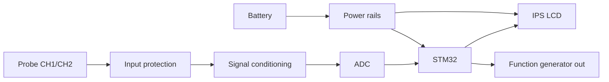

  

 

## ⚡ Who Am I

I like hardware that **works on the bench, then keeps working**: sensible derating, clean power, protected inputs, and tests that go past "it powers on." 🔬

---

## 🔥 Currently

---

## 🧪 Featured projects

<!-- Replace YOUR_USERNAME and make sure each repo name matches yours -->

  
  

  
  

  
  

### 🧬 Signal chain of the test instrument

---

## 🛠️ Toolbox

<b>📖 Full skill breakdown (click to expand)</b>

 

| Area | What I do |
|---|---|
| **Hardware design** | Schematic capture, multi-layer PCB layout, component selection, datasheet analysis, BOM management, derating, DFM/DFT basics |
| **Analog & power** | LDO / buck / boost supplies, MOSFET gate drive, op-amp signal conditioning, ADC/DAC interfacing, power integrity & decoupling |
| **High-reliability** | Space-grade & high-precision component research, package/footprint review, operating-limit review, endurance testing |
| **Video & digital interfaces** | PAL/NTSC, HDMI, LVDS, DDR, PCIe, signal-integrity awareness, FPGA-facing signal paths |
| **Validation & lab** | Board bring-up, fault isolation, test planning, test reports; oscilloscope, logic analyzer, DMM, bench supplies |
| **Embedded** | STM32, ESP32, Raspberry Pi Pico, Arduino · I2C, UART, SPI · firmware-hardware integration |

---

## 💼 Experience

<b>🛰️ Hardware Intern · Bit Mapper Integration</b> &nbsp;|&nbsp; Aug 2026 – Jan 2027

 

- 🔌 Supporting integration & debugging of **HDMI, LVDS, DDR, PCIe**, plus **PAL/NTSC analog-video paths** and **FPGA-facing signals**
- 🔍 Researching **space-grade & high-reliability components** from datasheets, package/footprint data and electrical specs
- 🧩 Contributing to hardware design: circuit-level investigation, component selection, interface engineering
- 📊 Running **high-precision characterization & endurance tests**; writing component comparisons, test records and technical reports for design reviews

<b>🤖 Robotics Intern (Workshop Team) · RoboHawk</b> &nbsp;|&nbsp; 3 months

 

- Built & tested **line-following and pick-and-place robots**: schematics, electronics integration, firmware, functional verification
- Ran **hands-on workshops** on embedded systems & robotics for students

---

## 🧭 My hardware rules

---

## 🎓 Education & certs

🎓 **B.E. Electronics & Telecommunication** · PCCOER, Ravet, Pune · Expected 2027 · **CGPA 9.0/10**

🏅 Altium Education: PCB Design &nbsp;·&nbsp; MathWorks: MATLAB Onramp &nbsp;·&nbsp; IIT Bombay (Spoken Tutorial): eSIM Training

---

## 📈 GitHub stats

<!-- Replace YOUR_USERNAME with your GitHub username -->

---

## 📫 Let's build something

Hiring for **PCB design, high-reliability electronics, video/FPGA interfaces or robotics hardware**? Or just want to nerd out over gate-drive layouts?

  

